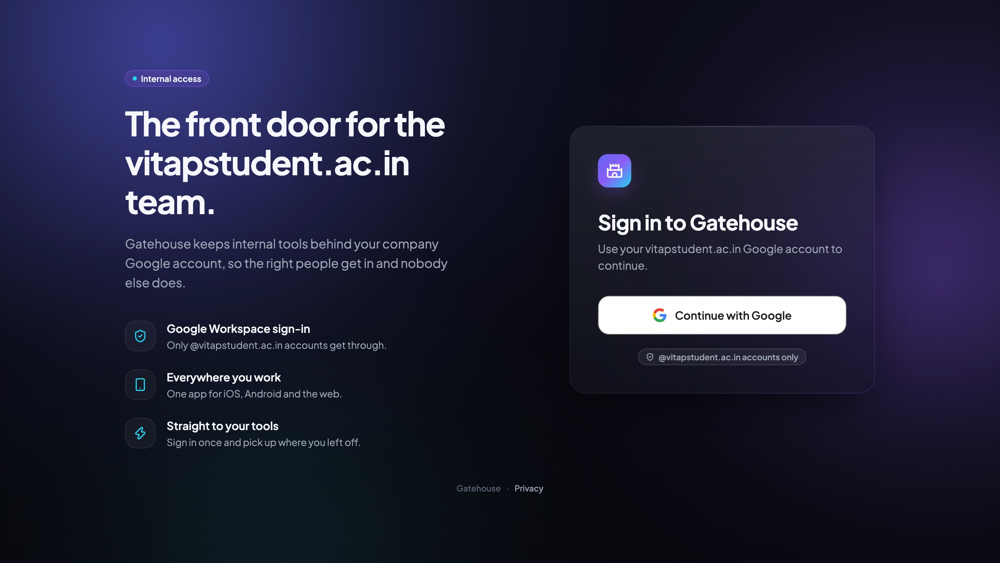
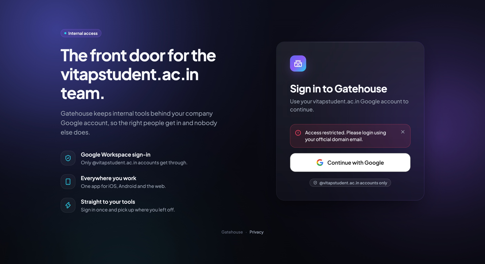
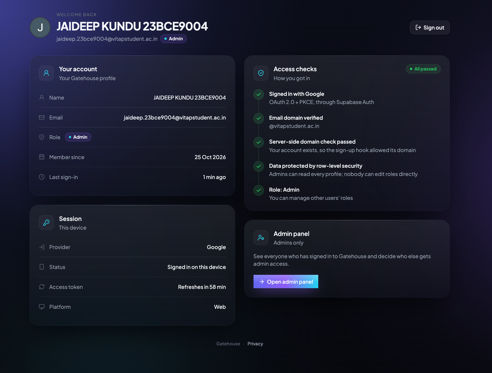
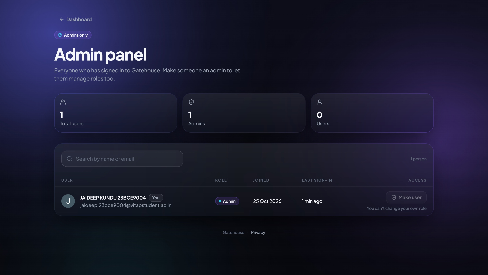
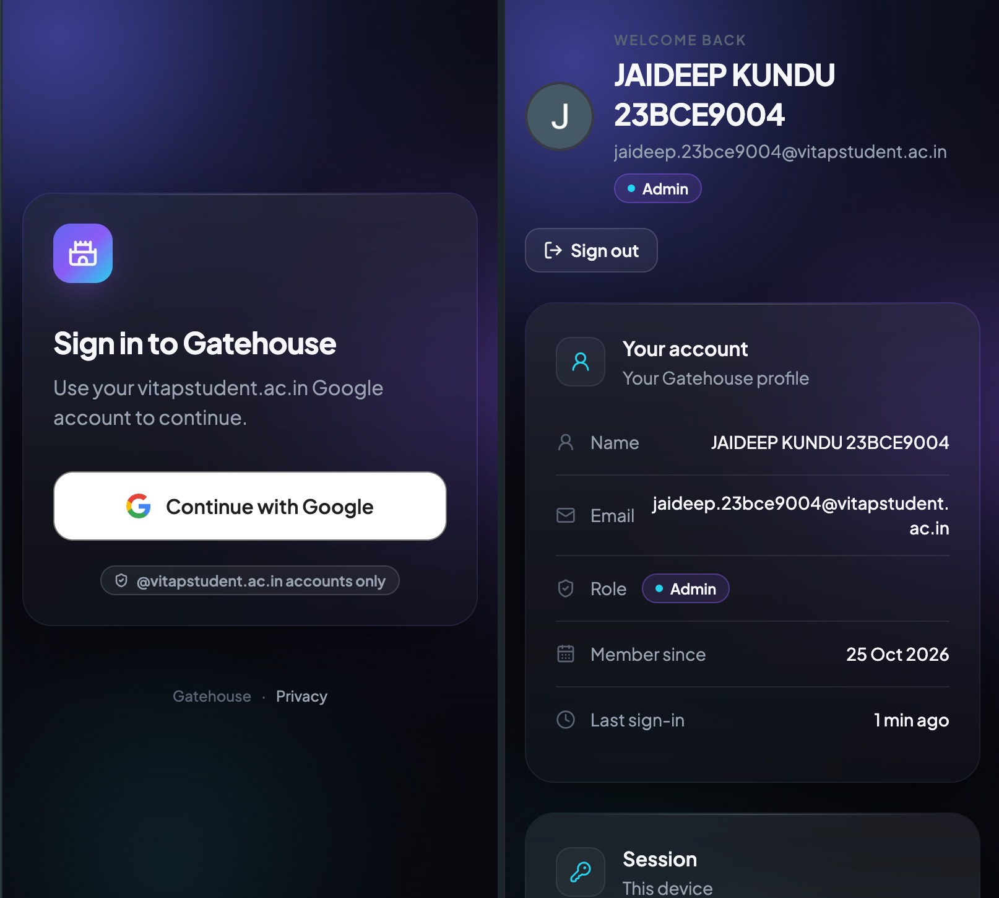
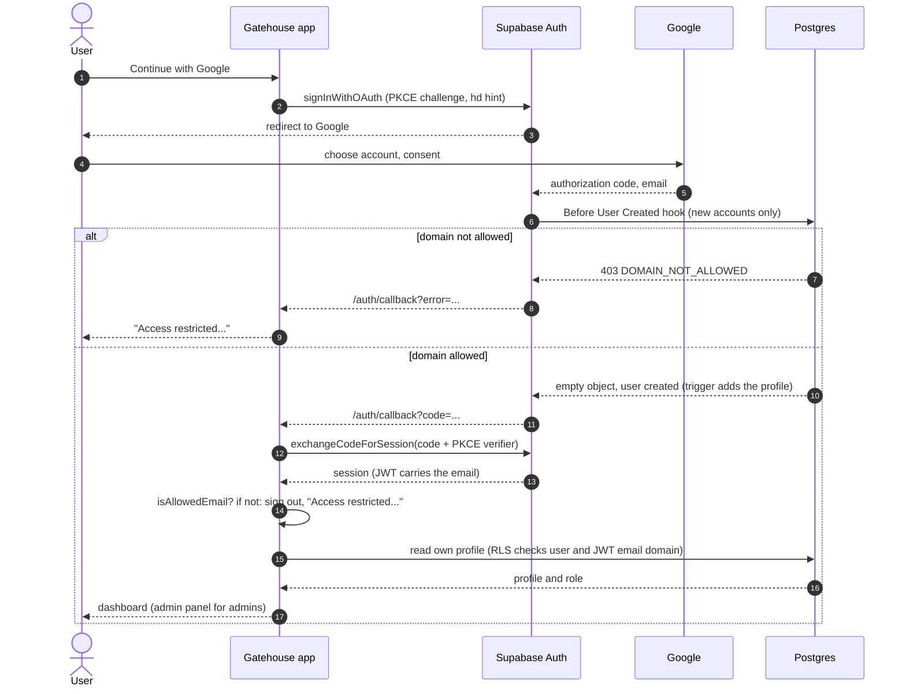

# Gatehouse

Sign in with Google, restricted to one company email domain, in a single Expo app for Android, iOS
and the web.

[](https://github.com/OWNER/REPO/actions/workflows/ci.yml)

**Live demo:** [LIVE_URL](LIVE_URL). It accepts **@vitapstudent.ac.in** accounts while it's being
reviewed, then moves to **@hbplus.fit** ([domain switch](docs/DEPLOYMENT.md#6-switch-the-allowed-domain)).
Any other Google account sees: _"Access restricted. Please login using your official domain
email."_

## Screenshots

| Login                                      | Access denied                                        | Dashboard                                    |
| ------------------------------------------ | ---------------------------------------------------- | -------------------------------------------- |
|        |  |  |
| **Admin panel**                            | **Mobile**                                           |                                              |
|  |                |                                              |

## Features

| Requirement                               | Where                                                                                                                                                                       |
| ----------------------------------------- | --------------------------------------------------------------------------------------------------------------------------------------------------------------------------- |
| Google Sign-In button                     | [`google-sign-in-button.tsx`](src/components/google-sign-in-button.tsx) (Google's branding rules), flow in [`lib/auth.ts`](src/lib/auth.ts)                                 |
| Domain validation                         | Client: [`utils/domain.ts`](src/utils/domain.ts). Server: [hook + RLS](supabase/migrations). See [domain restriction](#how-domain-restriction-works)                        |
| Exact error for other domains             | `ACCESS_DENIED_MESSAGE` in [`utils/domain.ts`](src/utils/domain.ts)                                                                                                         |
| Login and Dashboard pages                 | [`(auth)/login.tsx`](<src/app/(auth)/login.tsx>), [`(app)/dashboard.tsx`](<src/app/(app)/dashboard.tsx>)                                                                    |
| Protected routes, also on direct web URLs | `Stack.Protected` guards in [`app/_layout.tsx`](src/app/_layout.tsx) and [`(app)/_layout.tsx`](<src/app/(app)/_layout.tsx>), SPA fallback in [`netlify.toml`](netlify.toml) |
| Logout                                    | Dashboard **Sign out**, `signOut()` in [`auth-context.tsx`](src/context/auth-context.tsx)                                                                                   |
| Loading states                            | Branded loader during the session check, button spinners, skeletons in the admin panel                                                                                      |
| Error handling                            | Friendly messages for cancel, network, OAuth and hook errors ([`oauth-callback.ts`](src/lib/oauth-callback.ts)); empty and error states with Retry                          |
| State management                          | One `AuthProvider` ([`auth-context.tsx`](src/context/auth-context.tsx)): status, session, profile, role                                                                     |
| Token handling                            | [PKCE, encrypted native storage, auto-refresh](#token-handling)                                                                                                             |
| **Bonus:** roles (Admin / User)           | `profiles.role`, admin panel [`(app)/admin.tsx`](<src/app/(app)/admin.tsx>), `set_user_role` RPC                                                                            |
| **Bonus:** user data in a database        | `public.profiles`, created by a trigger on sign-up                                                                                                                          |
| **Bonus:** properly protected routes      | Client guards for UX, and RLS on the server for the data itself                                                                                                             |
| Also                                      | Public [privacy page](src/app/privacy.tsx), themed 404, CI, SQL tests                                                                                                       |

## Tech stack

- **App:** Expo SDK 57, React Native 0.86, React 19, TypeScript, Expo Router (file-based routes in
  `src/app`), NativeWind 4 (Tailwind), Reanimated 4, expo-blur, lucide icons, Plus Jakarta Sans
- **Auth and data:** Supabase Auth (Google, PKCE) and Postgres (auth hook, triggers, RLS)
- **Native storage:** expo-secure-store, expo-crypto (AES-GCM), AsyncStorage
- **Tests:** Jest (jest-expo) with React Native Testing Library; SQL tests on PGlite
- **Hosting and CI:** Netlify (static single-page web build), GitHub Actions

## Authentication flow



- **Web:** `signInWithOAuth` sends the whole page to Google. Supabase redirects back to
  `/auth/callback?code=...`, and supabase-js exchanges the code on load (`detectSessionInUrl`).
- **iOS / Android:** the app gets the Google URL from Supabase, opens it with
  `WebBrowser.openAuthSessionAsync`, reads `code` from the returned `gatehouse://auth/callback` URL
  and calls `exchangeCodeForSession` itself.
- Until the stored session and the profile are loaded, the app shows only a branded loader: no
  flash of the dashboard or of the login page. Closing Google's sheet is not an error. Network
  and OAuth errors become short messages, and the provider's raw error text is never shown.

## How domain restriction works

Three layers, each with its own job. Only the last two are enforcement.

1. **Google's `hd` hint** pre-filters the account picker to the allowed domain. It's a UX hint:
   anyone can strip it from the URL or pick "Use another account".
2. **Client check** ([`isAllowedEmail`](src/utils/domain.ts)): the part after the single `@` must
   exactly equal `EXPO_PUBLIC_ALLOWED_DOMAIN`, so `mail.<domain>`, `x<domain>` and
   `<domain>.evil.com` are rejected. Every session that appears, restored or new, is checked; a
   failing one is signed out at once, is never exposed as signed in, and the login page shows
   _"Access restricted. Please login using your official domain email."_
3. **Server**:
   - A **Before User Created** auth hook refuses to create any user whose email domain isn't in
     `public.allowed_domains` (same exact-match rule). A rejected account never gets a row in
     `auth.users`, a session or a profile. The app maps the hook's `DOMAIN_NOT_ALLOWED` error to
     the same message.
   - **Row-level security** on `profiles` also requires the email in the caller's JWT to be on an
     allowed domain, so even an account created before the hook existed can read nothing.

**Why the client check isn't enough:** the app's code runs on the user's device and can be
changed, and the Supabase API is public (the publishable key ships in every client). Without the
server layers, a Google account from any domain could get a Supabase session by calling the API
directly, and read data with it. The client check is about UX: an immediate, clear message.

To see the server layers work, set `EXPO_PUBLIC_GOOGLE_HD_HINT=false`, so Google offers every
account, and sign in with a personal Gmail account: it's still rejected.

## Roles and data security

- **`public.profiles`**: one row per user (`id`, `email`, `full_name`, `avatar_url`, `role` of
  `admin` or `user`, `created_at`, `last_sign_in_at`). A trigger creates it from the Google
  profile at sign-up and keeps `last_sign_in_at` in sync.
- **RLS**: a user reads their own row; an admin reads every row. Both policies also require an
  allowed JWT email domain. No insert, update or delete policies exist, so nobody can change their
  own role, and `anon` has no access at all. `allowed_domains` is unreadable by clients.
- **`set_user_role(target, new_role)`**: the only way to change a role. It checks on the server
  that the caller is an admin on an allowed domain, refuses self-demotion (so one admin always
  remains), and locks rows so two admins demoting each other at once can't both succeed.
- **Admin bootstrap**: while there is no _current_ admin (an admin whose email is on an allowed
  domain), the next allowed user to sign up becomes admin. That gives a fresh project an admin
  without SQL, and gives the new domain one after a [domain switch](docs/DEPLOYMENT.md#6-switch-the-allowed-domain).
  An advisory lock stops two simultaneous first sign-ups from both becoming admin.
  **Trade-off:** whoever signs up first while there is no admin gets admin rights. Sign in yourself
  right after deploying or switching domains, and check `profiles` (see
  [SUPABASE_SETUP](docs/SUPABASE_SETUP.md#5-make-yourself-admin)).

The UI hides `/admin` from non-admins, but the security comes from RLS: a non-admin who reaches
the API directly still gets only their own row.

## Token handling

- **PKCE** for every sign-in: the authorization code in the redirect is useless without the
  verifier that only this device holds.
- **Native:** the session is encrypted with AES-256-GCM (expo-crypto). The key lives in the
  Keychain / Keystore via SecureStore, the ciphertext in AsyncStorage, since sessions can be too
  big for SecureStore alone. Tampered or mismatched data is rejected, not trusted.
- **Web:** supabase-js keeps the session in `localStorage`. **Trade-off:** script running on the
  page (an XSS bug) could read it. Mitigated by having no third-party scripts, React's output
  escaping, one-hour access tokens and refresh-token rotation. HttpOnly cookies would need a
  server, which this static app doesn't have.
- **Auto-refresh:** supabase-js refreshes tokens before they expire; on native only while the app
  is in the foreground (AppState).
- Only the **publishable (anon) key** is in the app. The `service_role` / secret key is not used
  anywhere, and tokens and sessions are never logged.

## Project structure

```
src/
  app/                 routes: login, dashboard, admin, privacy, auth/callback, 404, layouts
  components/          ui/ (design system), dashboard/, admin/, Google button, loader
  context/             AuthProvider: session, profile, role, sign-in / sign-out
  lib/                 Supabase client, Google flow, profiles + set_user_role, OAuth callbacks
  utils/ hooks/        domain check, date formatting, list helpers, useNow, useProfileList
  config/ constants/   typed env, design tokens, legal constants
supabase/migrations/   SQL: allowed domains, auth hook, profiles, RLS, roles, admin bootstrap
supabase/tests/        SQL tests (PGlite)
docs/                  SUPABASE_SETUP.md, DEPLOYMENT.md, screenshots/
netlify.toml           build, SPA fallback, security and cache headers
```

## Local setup

**Prerequisites:** Node 24 (as in CI; 20.19+ and 22.13+ also work), npm, a Supabase project, and a
Google Cloud OAuth client (web application).

```bash
npm ci
cp .env.example .env   # fill in the values below
npm run web            # or: npm start, then i / a for a simulator, or scan the QR in Expo Go
```

| Variable                        | Required        | Value                                                                           |
| ------------------------------- | --------------- | ------------------------------------------------------------------------------- |
| `EXPO_PUBLIC_SUPABASE_URL`      | Yes             | `https://<project>.supabase.co`                                                 |
| `EXPO_PUBLIC_SUPABASE_ANON_KEY` | Yes             | Publishable key (`sb_publishable_...`) or legacy anon key, never the secret key |
| `EXPO_PUBLIC_ALLOWED_DOMAIN`    | No (hbplus.fit) | The one allowed domain, without `@`. Must match `allowed_domains`               |
| `EXPO_PUBLIC_GOOGLE_HD_HINT`    | No (on)         | `false` drops Google's `hd` hint, to test the rejection flow only               |

`EXPO_PUBLIC_*` values are bundled into the app, so they must not be secrets. Restart with
`npx expo start -c` after changing them.

- **Supabase:** enable the Google provider, add the redirect URLs, run the migrations and enable
  the hook: [docs/SUPABASE_SETUP.md](docs/SUPABASE_SETUP.md). Redirect URLs for local work:
  `http://localhost:8081/**`, `gatehouse://auth/callback`, and `exp://**` for Expo Go.
- **Deploying:** [docs/DEPLOYMENT.md](docs/DEPLOYMENT.md).

## Testing

| Command                | What it runs                                                                            |
| ---------------------- | --------------------------------------------------------------------------------------- |
| `npm test`             | Jest: domain check, OAuth handling, auth context, guards, dashboard, admin panel, pages |
| `npm run test:sql`     | The real migrations on PGlite (in-memory Postgres): hook, RLS, grants, roles, bootstrap |
| `npm run typecheck`    | TypeScript                                                                              |
| `npm run lint`         | ESLint (Expo config + Prettier)                                                         |
| `npm run format:check` | Prettier                                                                                |

- **Jest** renders the real `src/app` routes with `expo-router/testing-library` and fakes only the
  Supabase client ([`fake-supabase.ts`](src/test-utils/fake-supabase.ts)), which applies the same
  rules as RLS and `set_user_role`.
- **SQL tests** ([`supabase/tests`](supabase/tests)) run every migration twice on a stand-in for a
  Supabase project's roles, grants and `auth` schema. No database or network needed.
- **CI** ([`.github/workflows/ci.yml`](.github/workflows/ci.yml)) runs install, type check, lint,
  Prettier, Jest and the SQL tests on every push and pull request. It needs no secrets.
- **Manual rejection test:** set `EXPO_PUBLIC_GOOGLE_HD_HINT=false`, restart with
  `npx expo start -c`, sign in with a Gmail account: you get the access-denied message, and
  `select count(*) from auth.users where email = '...'` in Supabase returns 0.

## Running on mobile

_To be completed after emulator and device testing._ Planned contents: Expo Go vs a development
build, the redirect URL for each, and Android / iOS specifics.

## Known limitations and next steps

- **Google's consent screen says "continue to `<project>.supabase.co`"**: the OAuth callback is on
  Supabase's domain. Showing your own domain needs a Supabase custom domain (paid add-on).
- **No Content-Security-Policy yet.** The other security headers are set in `netlify.toml`; a CSP
  needs care to allow Google sign-in, Supabase and fonts. Next step: start in report-only mode.
- **Security Advisor** may flag `email_domain_allowed`, `is_admin` and `set_user_role` as
  security-definer functions callable by `authenticated`. Intentional: RLS needs the first two and
  `set_user_role` checks the caller itself. Moving them to a private schema would silence it.
- **Session on the web lives in `localStorage`** (see [token handling](#token-handling)).
- **Role changes apply on the next load:** the app reads the role when the session loads.
- **Starting offline signs you out**, because the profile can't be loaded. That's deliberate: no
  half-signed-in state.
- **Deleted users' access tokens** stay valid until they expire (an hour by default), though RLS
  still gives them nothing.
- **Admin bootstrap** trusts whoever signs up first when there's no admin (see above).
- **Native** builds haven't been tested on devices yet (see "Running on mobile").
